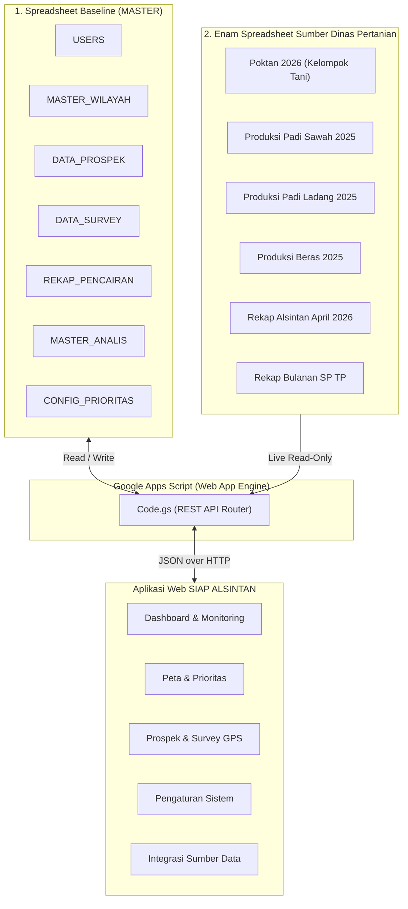
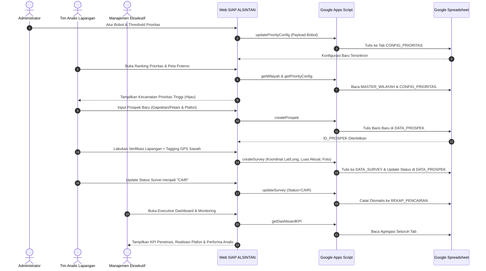

# ARSITEKTUR DATA DAN PEMETAAN GOOGLE SPREADSHEET
# SISTEM INFORMASI DAN ANALISIS POTENSI ALSINTAN (SIAP ALSINTAN)

> **Dokumen Sumber untuk Google NotebookLM & Bahan Presentasi Eksekutif**  
> **Versi:** 1.1.0  
> **Tanggal Pembaruan:** 01 Oktober 2026  
> **Sifat Dokumen:** Komprehensif & Referensi Arsitektur Data

---

## 1. RINGKASAN EKSEKUTIF SISTEM

### 1.1 Profil Aplikasi
**SIAP ALSINTAN** (*Sistem Informasi dan Analisis Potensi Alsintan*) adalah platform analitik dan operasional berbasis web yang dirancang untuk mendukung pembiayaan alat dan mesin pertanian (Alsintan) secara tepat sasaran, akuntabel, dan berbasis data spasial-geografis.

Platform ini memadukan:
- **Analisis Makro Kewilayahan:** Pemetaan potensi luas lahan sawah, populasi kelompok tani, dan tonase panen.
- **Priority Engine (MCDM):** Penentuan peringkat wilayah kecamatan paling potensial untuk penetrasi pembiayaan alsintan secara otomatis.
- **Pipeline Manajemen Prospek:** Pengelolaan siklus penjualan alsintan dari prospek baru hingga pencairan kredit.
- **Validasi Lapangan Terverifikasi:** Survei fisik petani dengan koordinat GPS anti-fraud dan dokumentasi foto lapangan.
- **Executive Monitoring:** Pelacakan performa tim analis lapangan dan evaluasi komparatif antara baseline dinas vs realisasi capaian.

### 1.2 Tech Stack & Arsitektur Data
- **Frontend Web App:** React 18, TypeScript, Vite, Tailwind CSS, TanStack React Query v5, Leaflet (Peta GIS), Recharts.
- **Backend API & Data Engine:** Google Apps Script (Serverless Web App API) via protokol JSON over HTTP (POST/GET).
- **Primary Database:** Google Spreadsheet (*Cloud Spreadsheet Database*) dengan replikasi cache lokal browser untuk performa instan (*offline-first readiness*).

---

## 2. ARSITEKTUR EKOSISTEM SPREADSHEET

Sistem SIAP ALSINTAN mengintegrasikan **1 Spreadsheet Master Utama** dan **6 Spreadsheet Sumber Eksternal** dari Dinas Pertanian.

### 2.1 Identitas File Database

#### A. Spreadsheet Database Utama
- **Nama File:** `SIAP ALSINTAN - Baseline (MASTER)`
- **Spreadsheet ID:** `1EZ3XYXRaCkJmHhLbhVkrzKqcFrtcN7DX3k7BNZc20F4`
- **Fungsi:** Menyimpan seluruh data master, data operasional, akun pengguna, dan konfigurasi runtime sistem.

#### B. Enam Spreadsheet Sumber Eksternal (Folder ALSINTAN)
1. **Poktan 2026** (`ID: 1xd4G2iCUBvyqUwuTni3anBOJhoQwmb-TNW1qOE4YBzg`): Master kelompok tani se-kabupaten.
2. **Produksi Padi Sawah 2025** (`ID: 1NEEZarMvHL11z2rXx0dS31KuiI0tAMJCIH_b11eYFQo`): Data panen padi sawah per kecamatan.
3. **Produksi Padi Ladang 2025** (`ID: 1G3x0B9Oxi4rfMoWTBJ3Ie-rIL2-dCrPV9vlh0BahvqQ`): Data panen padi gogo/ladang.
4. **Produksi Beras 2025** (`ID: 1s41NFQjZBdlQWW_6d-NBNMnEkYLufyf-Z-bCgaxOiC4`): Estimasi konversi gabah ke beras per wilayah.
5. **Rekap Alsintan s.d. April 2026** (`ID: 1z5zDzvksX5xT6C_OvM_Kv_cFYPuGdOPvAKxsxp7LBoY`): Inventaris alat pertanian yang sudah ada di lapangan.
6. **Rekap Bulanan SP TP** (`ID: 1DzlqupA0M-6Ehs6QSwTo_o7oU_g7uVYROCSr8aiuzt8`): Laporan bulanan statistik pertanian tanaman pangan.

---

## 3. MATRIKS LENGKAP: HALAMAN WEB VS SPREADSHEET

| No | Halaman Web | URL Route | Spreadsheet | Tab (Sheet) | Akses | Action API di `Code.gs` | Data yang Dikelola |
|:---:|---|---|---|---|:---:|---|---|
| **1** | **Login & Autentikasi** | `/login` | Baseline MASTER | `USERS` | **Read** | `authCheck` | Verifikasi kredensial email, nama pengguna, dan pemetaan role (ADMIN, ANALIS, MANAJEMEN). |
| **2** | **Executive Dashboard** | `/` | Baseline MASTER | `MASTER_WILAYAH` `DATA_PROSPEK` `DATA_SURVEY` `REKAP_PENCAIRAN` `MASTER_ANALIS` | **Read** | `getDashboardKPI` `getWilayah` `getProspek` `getSurvey` `getRekapPencairan` | KPI ringkasan eksekutif: total potensi luas baku sawah, pipeline prospek, rasio realisasi survei, plafon cair (Rp), dan sebaran komoditas. |
| **3** | **Peta Potensi Interaktif** | `/peta` | Baseline MASTER | `MASTER_WILAYAH` `DATA_PROSPEK` `CONFIG_PRIORITAS` | **Read** | `getWilayah` `getProspek` `getPriorityConfig` | Koordinat titik/poligon kecamatan, luas lahan (ha), tonase panen, serta pewarnaan zonasi wilayah (Hijau=Tinggi, Kuning=Sedang, Abu-abu=Rendah). |
| **4** | **Ranking Prioritas Wilayah** | `/prioritas` | Baseline MASTER | `MASTER_WILAYAH` `DATA_PROSPEK` `CONFIG_PRIORITAS` | **Read** | `getWilayah` `getProspek` `getPriorityConfig` | Perhitungan peringkat kecamatan berdasarkan bobot dinamis: Luas Lahan, Jumlah Gapoktan, Produksi Panen, dan Penetrasi Pasar Eksisting (Inverse). |
| **5** | **Pipeline Data Prospek** | `/prospek` | Baseline MASTER | `DATA_PROSPEK` `MASTER_WILAYAH` `MASTER_ANALIS` | **Read / Write** | `getProspek` `createProspek` `updateProspek` `deleteProspek` | Pencatatan prospek perorangan/gapoktan baru, pemilihan komoditas, kebutuhan alat, nominal estimasi plafon (dengan format ribuan), penugasan Analis, dan tahapan status pipeline. |
| **6** | **Survey & GPS Lapangan** | `/survey` | Baseline MASTER | `DATA_SURVEY` `DATA_PROSPEK` `REKAP_PENCAIRAN` | **Read / Write** | `getSurvey` `createSurvey` `updateSurvey` | Hasil verifikasi faktual lapangan: nama ketua, anggota, luas aktual, jenis alat, nominal plafon, koordinat GPS (Lat/Long/Akurasi Meter), foto dokumentasi, dan otomatis mencatat ke `REKAP_PENCAIRAN` saat status disburse/cair. |
| **7** | **Kinerja & Tim Analis** | `/analis` | Baseline MASTER | `MASTER_ANALIS` `DATA_PROSPEK` `DATA_SURVEY` | **Read / Write** | `getAnalis` `createAnalis` `updateAnalisStatus` | Manajemen data analis (status Aktif/Nonaktif, wilayah penugasan, email) dan kalkulasi otomatis beban kerja (jumlah prospek ditangani & survei diselesaikan). |
| **8** | **Monitoring & Evaluasi** | `/monitoring` | Baseline MASTER | `MASTER_WILAYAH` `DATA_PROSPEK` `DATA_SURVEY` `MASTER_ANALIS` | **Read** | `getWilayah` `getProspek` `getAnalis` | Analisis kesenjangan (*gap analysis*) antara potensi statistik dinas vs realisasi capaian tim penjualan di lapangan, serta peringkat produktivitas analis. |
| **9** | **Sumber Data Terpadu** | `/sumber-data` | 6 Spreadsheet Dinas + Master | Seluruh Sheet Sumber | **Read-Only** | `getSources` `getSourceData` `getPoktan` | Penelusuran data mentah (*live data browser*) dari 6 spreadsheet dinas pertanian tanpa perlu mengunduh file Excel secara manual. |
| **10** | **Pengaturan Sistem** | `/pengaturan` | Baseline MASTER | `CONFIG_PRIORITAS` | **Read / Write** | `getPriorityConfig` `updatePriorityConfig` `ping` | Penyesuaian persentase bobot formula scoring prioritas dan batas threshold kategori. Tersimpan di spreadsheet dan berlaku global ke seluruh pengguna. |

---

## 4. PENJELASAN MENDALAM PER HALAMAN

### 4.1 Halaman Login & Autentikasi (`/login`)
- **Tujuan Bisnis:** Memastikan keamanan sistem dan pembatasan akses berbasis peran (*Role-Based Access Control*).
- **Tab Terhubung:** `USERS`
- **Alur Kerja:**
  1. Pengguna memasukkan alamat email terdaftar.
  2. Sistem mengirimkan permintaan `authCheck` ke Apps Script.
  3. Backend mencocokkan email pada tab `USERS` dan mengembalikan profil pengguna beserta role:
     - `ADMIN`: Akses penuh konfigurasi sistem, data analis, dan override formula.
     - `ANALIS`: Akses operasional untuk input prospek dan survei GPS lapangan.
     - `MANAJEMEN`: Akses pengawasan, pembacaan dashboard eksekutif, peta potensi, dan evaluasi target.

---

### 4.2 Executive Dashboard (`/`)
- **Tujuan Bisnis:** Pusat kendali pimpinan untuk memantau performa pembiayaan alsintan dalam satu tampilan menyeluruh.
- **Tab Terhubung:** `MASTER_WILAYAH`, `DATA_PROSPEK`, `DATA_SURVEY`, `REKAP_PENCAIRAN`, `MASTER_ANALIS`.
- **Indikator Kunci (KPI) yang Ditampilkan:**
  - Total Luas Lahan Potensial se-Kabupaten (Hektar).
  - Jumlah Total Gapoktan dan Kelompok Tani terdaftar.
  - Funnel Pipeline Prospek: `BARU` ➔ `DALAM_PROSPEK` ➔ `SURVEY` ➔ `POTENSIAL` ➔ `CLOSING` ➔ `CAIR`.
  - Total Plafon Pencairan Kredit Alsintan (Rupiah).
  - Peringkat 4 Kecamatan Teratas (*Top Recommended Wilayah*).

---

### 4.3 Peta Potensi Interaktif (`/peta`)
- **Tujuan Bisnis:** Alat visualisasi geospasial untuk mengidentifikasi konsentrasi lahan dan peluang pasar alsintan.
- **Tab Terhubung:** `MASTER_WILAYAH`, `DATA_PROSPEK`, `CONFIG_PRIORITAS`.
- **Mekanisme Kerja:**
  - Mengambil koordinat lintang dan bujur (*Latitude/Longitude*) dari `MASTER_WILAYAH`.
  - Menghitung skor prioritas setiap kecamatan secara real-time.
  - Memberikan pewarnaan marker/zona:
    - 🟢 **Hijau (Prioritas Tinggi):** Wilayah dengan lahan luas, gapoktan kuat, panen melimpah, dan penetrasi prospek masih minim.
    - 🟡 **Kuning (Prioritas Sedang):** Wilayah berpotensi sedang atau sudah memiliki penetrasi prospek moderat.
    - ⚪ **Abu-abu / Merah (Prioritas Rendah):** Wilayah dengan lahan terbatas atau pasar sudah jenuh.

---

### 4.4 Ranking Prioritas Wilayah (`/prioritas`)
- **Tujuan Bisnis:** Memberikan rekomendasi berbasis algoritma kepada tim sales/analis mengenai kecamatan mana yang harus didatangi terlebih dahulu.
- **Tab Terhubung:** `MASTER_WILAYAH`, `DATA_PROSPEK`, `CONFIG_PRIORITAS`.
- **Formula Multi-Criteria Decision Making (MCDM):**
  $$\text{Priority Score} = (S_{\text{lahan}} \times W_{\text{lahan}}) + (S_{\text{gapoktan}} \times W_{\text{gapoktan}}) + (S_{\text{produksi}} \times W_{\text{produksi}}) + (S_{\text{prospek}} \times W_{\text{prospek}})$$
  - *Luas Lahan ($W_{\text{lahan}}$):* Standar 30%
  - *Jumlah Gapoktan ($W_{\text{gapoktan}}$):* Standar 25%
  - *Produksi Panen ($W_{\text{produksi}}$):* Standar 25%
  - *Pipeline Prospek Eksisting ($W_{\text{prospek}}$):* Standar 20% (bersifat *inverse*: semakin sedikit prospek yang masuk, semakin tinggi skor peluang penetrasinya).
- **Threshold Default:** Skor $\ge 70$ (Tinggi), $\ge 40$ (Sedang), $< 40$ (Rendah).

---

### 4.5 Pipeline Data Prospek Alsintan (`/prospek`)
- **Tujuan Bisnis:** Manajemen siklus hidup calon nasabah pembiayaan alsintan.
- **Tab Terhubung:** `DATA_PROSPEK` (Read/Write), `MASTER_WILAYAH` (Read), `MASTER_ANALIS` (Read).
- **Fitur Utama:**
  - Pendaftaran prospek baru perorangan maupun kelompok tani.
  - Dropdown wilayah kecamatan terintegrasi langsung dari `MASTER_WILAYAH`.
  - Penugasan analis penanggung jawab terintegrasi dari `MASTER_ANALIS`.
  - Input **Estimasi Plafon (Rp)** dilengkapi pemisah ribuan otomatis (contoh: `45.000.000`) untuk kenyamanan entri data finansial.
  - Mekanisme *Soft Delete*: Prospek yang dihapus tidak menghapus baris fisik spreadsheet, melainkan ditandai `TIDAK_POTENSIAL | Dinonaktifkan [Tanggal]`, sehingga riwayat integritas data survei tetap terjaga.

---

### 4.6 Survey & Geolocation GPS Lapangan (`/survey`)
- **Tujuan Bisnis:** Verifikasi faktual kondisi fisik petani pemohon alsintan guna memitigasi risiko kredit fiktif.
- **Tab Terhubung:** `DATA_SURVEY` (Read/Write), `DATA_PROSPEK` (Read/Update), `REKAP_PENCAIRAN` (Write).
- **Fitur Validasi Lapangan:**
  - **GPS Tagging Real-time:** Mengambil koordinat GPS akurat dari perangkat browser analis saat berada di sawah beserta indikator akurasi meter.
  - **Verifikasi Lahan Aktual:** Membandingkan klaim luas sawah dengan kondisi faktual di lapangan.
  - **Upload Foto Dokumentasi:** Tautan foto dokumentasi kondisi lahan / alsintan eksisting.
  - **Otomatisasi Disburse:** Ketika status survei diperbarui menjadi `CAIR` atau `DISBURSE`, backend Apps Script secara otomatis menambahkan baris rekapitulasi pencairan ke tab `REKAP_PENCAIRAN`.

---

### 4.7 Kinerja & Tim Analis (`/analis`)
- **Tujuan Bisnis:** Pengelolaan portofolio sumber daya manusia dan pemantauan produktivitas tim lapangan.
- **Tab Terhubung:** `MASTER_ANALIS` (Read/Write), `DATA_PROSPEK` (Read), `DATA_SURVEY` (Read).
- **Fitur Utama:**
  - Master data analis: ID Analis, Nama, Wilayah Tugas Pokok, Email, dan Status (AKTIF / TIDAK_AKTIF).
  - Rekap beban kerja real-time: Jumlah prospek aktif yang ditangani dan jumlah survei lapangan yang telah diselesaikan.
  - Penonaktifan akun analis secara dinamis tanpa menghapus data historis penugasan.

---

### 4.8 Monitoring & Evaluasi Baseline vs Realisasi (`/monitoring`)
- **Tujuan Bisnis:** Mengukur efektivitas penetrasi pembiayaan alsintan terhadap potensi riil wilayah.
- **Tab Terhubung:** `MASTER_WILAYAH`, `DATA_PROSPEK`, `DATA_SURVEY`, `MASTER_ANALIS`.
- **Analisis Komparatif:**
  - Grafik perbandingan antara **Potensi Luas Lahan (Dinas)** dengan **Luas Sawah Terlayani (Realisasi Survei)** per kecamatan.
  - Leaderboard tim analis berdasarkan kecepatan survei dan tingkat keberhasilan pencairan kredit.

---

### 4.9 Sumber Data Terpadu & Sinkronisasi Eksternal (`/sumber-data`)
- **Tujuan Bisnis:** Menyediakan transparansi data mentah dinas pertanian bagi analis kredit tanpa harus meminta file Excel secara berulang.
- **Spreadsheet Terhubung:** 6 File Spreadsheet Eksternal Dinas Pertanian.
- **Fitur Utama:**
  - Penelusuran data kelompok tani (*Master Poktan 2026*) berdasarkan nama kelompok, desa, atau kecamatan.
  - Pengecekan riwayat alokasi bantuan alsintan pemerintah per wilayah untuk menghindari duplikasi bantuan.
  - Akses baca langsung (*live read-only*) dengan mekanisme caching cepat.

---

### 4.10 Pengaturan Sistem & Konfigurasi Prioritas (`/pengaturan`)
- **Tujuan Bisnis:** Memberikan kewenangan penuh kepada Administrator untuk menyesuaikan kebijakan bisnis bank/lembaga pembiayaan secara fleksibel.
- **Tab Terhubung:** `CONFIG_PRIORITAS` (Read/Write).
- **Fitur Utama:**
  - **Penyimpanan Multi-User Global:** Bobot persentase indikator dan threshold prioritas tersimpan langsung ke Google Spreadsheet, sehingga seluruh user (Manajemen, Analis, Dashboard) menikmati keseragaman ranking.
  - **Stempel Audit:** Mencatat tanggal dan akun pengguna yang terakhir kali mengubah konfigurasi prioritas.
  - **Proteksi Mode Produksi:** URL Google Apps Script otomatis dikunci (*read-only*) pada lingkungan produksi untuk mencegah kerusakan koneksi yang tidak disengaja.
  - **Alat Uji Konektivitas:** Tombol *Test Koneksi (Ping)* untuk memastikan ketersediaan server Apps Script dan Google Sheets secara real-time.

---

## 5. SKEMA STRUKTUR TAB SPREADSHEET UTAMA

Berikut adalah susunan kolom fisik pada Google Spreadsheet `SIAP ALSINTAN - Baseline (MASTER)`:

### Tab 1: `USERS`
| Nama Kolom | Tipe Data | Deskripsi |
|---|---|---|
| `EMAIL` | String (Key) | Alamat email terdaftar pengguna |
| `NAMA` | String | Nama lengkap pengguna |
| `ROLE` | Enum | `ADMIN`, `ANALIS`, atau `MANAJEMEN` |
| `STATUS` | Enum | `AKTIF` atau `NONAKTIF` |

### Tab 2: `MASTER_WILAYAH`
| Nama Kolom | Tipe Data | Deskripsi |
|---|---|---|
| `ID_KECAMATAN` | String (Key) | Kode unik kecamatan (contoh: `W001`) |
| `KECAMATAN` | String | Nama kecamatan |
| `KABUPATEN` | String | Nama kabupaten (Karawang / Purworejo) |
| `LUAS_LAHAN_HA` | Number | Luas baku lahan sawah (hektar) |
| `DATA_PANEN_TON` | Number | Estimasi volume produksi padi tahunan (ton) |
| `JUMLAH_GAPOKTAN` | Number | Jumlah gabungan kelompok tani terdaftar |
| `KOMODITAS` | String | Komoditas unggulan (Padi, Jagung, dll.) |
| `LATITUDE` | Number | Titik koordinat lintang pusat kecamatan |
| `LONGITUDE` | Number | Titik koordinat bujur pusat kecamatan |
| `CATATAN` | String | Catatan khusus karakteristik wilayah |

### Tab 3: `DATA_PROSPEK`
| Nama Kolom | Tipe Data | Deskripsi |
|---|---|---|
| `ID_PROSPEK` | String (Key) | ID unik prospek (contoh: `P001` atau kode Poktan) |
| `ID_KECAMATAN` | String | Relasi ke `MASTER_WILAYAH` |
| `KECAMATAN` | String | Nama kecamatan lokasi prospek |
| `NAMA_PROSPEK` | String | Nama petani perorangan atau gapoktan |
| `KOMODITAS` | String | Komoditas utama yang diusahakan |
| `ID_ANALIS` | String | Relasi ke `MASTER_ANALIS` |
| `NAMA_ANALIS` | String | Nama analis penanggung jawab |
| `STATUS` | Enum | `BARU`, `DALAM_PROSPEK`, `SURVEY`, `POTENSIAL`, `TIDAK_POTENSIAL`, `CLOSING`, `DISBURSE`, `CAIR` |
| `TANGGAL` | Date (YYYY-MM-DD) | Tanggal registrasi prospek |
| `ESTIMASI_ALSINTAN` | String | Jenis dan unit alat yang dibutuhkan |
| `ESTIMASI_PLAFON` | Number | Nominal estimasi nilai pembiayaan (Rp) |
| `CATATAN` | String | Catatan prospek atau penanda soft delete |

### Tab 4: `DATA_SURVEY`
| Nama Kolom | Tipe Data | Deskripsi |
|---|---|---|
| `ID_SURVEY` | String (Key) | ID unik survei (contoh: `S001`) |
| `ID_PROSPEK` | String | Relasi ke `DATA_PROSPEK` |
| `NAMA_PROSPEK` | String | Nama nasabah / kelompok tani |
| `JUMLAH_ANGGOTA` | Number | Jumlah anggota kelompok tani aktif |
| `LUAS_SAWAH_AKTUAL` | Number | Luas sawah terverifikasi lapangan (Ha) |
| `JENIS_ALSINTAN` | String | Tipe alsintan yang diverifikasi |
| `ESTIMASI_HARGA` | Number | Estimasi harga riil alat / plafon yang diajukan |
| `LATITUDE` | Number | Koordinat GPS lintang hasil tagging lapangan |
| `LONGITUDE` | Number | Koordinat GPS bujur hasil tagging lapangan |
| `ACCURACY_M` | Number | Tingkat akurasi GPS perangkat (meter) |
| `CATATAN` | String | Evaluasi kelayakan dari analis lapangan |
| `ID_ANALIS` | String | ID analis yang melakukan survei |
| `NAMA_ANALIS` | String | Nama analis yang melakukan survei |
| `TIMESTAMP` | DateTime | Waktu pelaksanaan survei fisik |
| `STATUS` | Enum | Status hasil survei (`SURVEY`, `LAYAK`, `CAIR`, dll.) |
| `FOTO_URL` | String | Tautan bukti foto survei di lapangan |
| `NAMA_KETUA` | String | Nama ketua kelompok tani / kontak pemohon |

### Tab 5: `REKAP_PENCAIRAN`
| Nama Kolom | Tipe Data | Deskripsi |
|---|---|---|
| `ID_PENCAIRAN` | String (Key) | ID transaksi pencairan (contoh: `PC001`) |
| `TANGGAL_PENCAIRAN` | Date | Tanggal pencairan dana alsintan |
| `ID_PROSPEK` | String | Relasi ke `DATA_PROSPEK` |
| `ID_SURVEY` | String | Relasi ke `DATA_SURVEY` |
| `NAMA_PROSPEK` | String | Nama nasabah penerima pembiayaan |
| `KECAMATAN` | String | Wilayah kecamatan |
| `JENIS_ALSINTAN` | String | Jenis alsintan yang dibiayai |
| `PLAFON_PENCAIRAN` | Number | Nominal kredit yang cair (Rp) |
| `ID_ANALIS` | String | ID analis penanggung jawab |
| `NAMA_ANALIS` | String | Nama analis penanggung jawab |
| `CATATAN` | String | Keterangan akad atau mekanisme disburse |

### Tab 6: `MASTER_ANALIS`
| Nama Kolom | Tipe Data | Deskripsi |
|---|---|---|
| `ID_ANALIS` | String (Key) | ID unik analis (contoh: `AN001`) |
| `NAMA_ANALIS` | String | Nama lengkap analis lapangan |
| `WILAYAH` | String | Wilayah kerja / basis penugasan |
| `STATUS` | Enum | `AKTIF` atau `TIDAK_AKTIF` |
| `EMAIL` | String | Alamat email resmi analis |

### Tab 7: `CONFIG_PRIORITAS`
| Nama Kolom | Tipe Data | Deskripsi |
|---|---|---|
| `ID_CONFIG` | String (Key) | ID konfigurasi (contoh: `CFG001`) |
| `BOBOT_LUAS_LAHAN` | Number | Bobot persentase luas sawah (misal: `0.30`) |
| `BOBOT_GAPOKTAN` | Number | Bobot persentase kelembagaan gapoktan (misal: `0.25`) |
| `BOBOT_PRODUKSI` | Number | Bobot persentase volume panen (misal: `0.25`) |
| `BOBOT_PROSPEK` | Number | Bobot persentase pasar eksisting (misal: `0.20`) |
| `THRESHOLD_TINGGI` | Number | Batas minimal skor kategori TINGGI (misal: `70`) |
| `THRESHOLD_SEDANG` | Number | Batas minimal skor kategori SEDANG (misal: `40`) |
| `UPDATED_AT` | DateTime | Waktu terakhir kali formula disimpan |
| `UPDATED_BY` | String | Akun admin yang melakukan perubahan |

---

## 6. SIKLUS HIDUP DATA BISNIS (END-TO-END WORKFLOW)

Alur sirkulasi data operasional pembiayaan alsintan di lapangan berlangsung secara berkesinambungan:

---

## 7. POIN UNGGULAN UNTUK BAHAN PRESENTASI (KEY TALKING POINTS)

1. **Zero Database Infrastructure Cost:**
   - Memanfaatkan ekosistem Google Spreadsheet dan Google Apps Script tanpa biaya langganan server database khusus (*free-tier cloud database*), namun tetap memiliki kemampuan RESTful API yang andal.
2. **Multi-Criteria Scoring Engine Terbuka & Dinamis:**
   - Penentuan prioritas kecamatan bukan asumsi subjektif, melainkan kalkulasi matematis objektif 4 pilar data.
   - Manajemen dapat menyesuaikan bobot secara fleksibel kapan saja melalui Halaman Pengaturan tanpa perlu mengubah baris kode program.
3. **Integritas Validasi Lapangan (Anti-Fraud GPS):**
   - Modul survei fisik dilengkapi pengambilan titik koordinat GPS riil dengan tingkat akurasi meter dan dokumentasi foto di tempat (*on-site verification*).
4. **Sinkronisasi Multi-Role Real-Time:**
   - Administrator, Analis, dan Manajemen melihat satu sumber kebenaran data (*single source of truth*) yang selalu diperbarui secara langsung di Google Spreadsheet.
5. **Kenyamanan Entri Finansial:**
   - Input nominal plafon dan estimasi pembiayaan secara otomatis diformat dengan separator ribuan (titik) untuk mencegah kesalahan penulisan angka nol.
